# OSPF Topology Watcher
OSPF Watcher is a monitoring tool of OSPF topology changes for network engineers. It listens passively to the OSPF control plane, either over its own OSPF adjacency on a GRE tunnel (GRE mode) or through BGP-LS updates from a router (BGP-LS mode). It sends the topology and every change to **Topolograph**: each adjacency, cost and prefix change appears on the graph and on its timeline.

> [!NOTE]
> Tracking OSPF topology changes via **BGP-LS** is **supported starting from Docker image `vadims06/ospf-watcher:v3.1.0`**.
> For older images, BGP-LS support is not available.

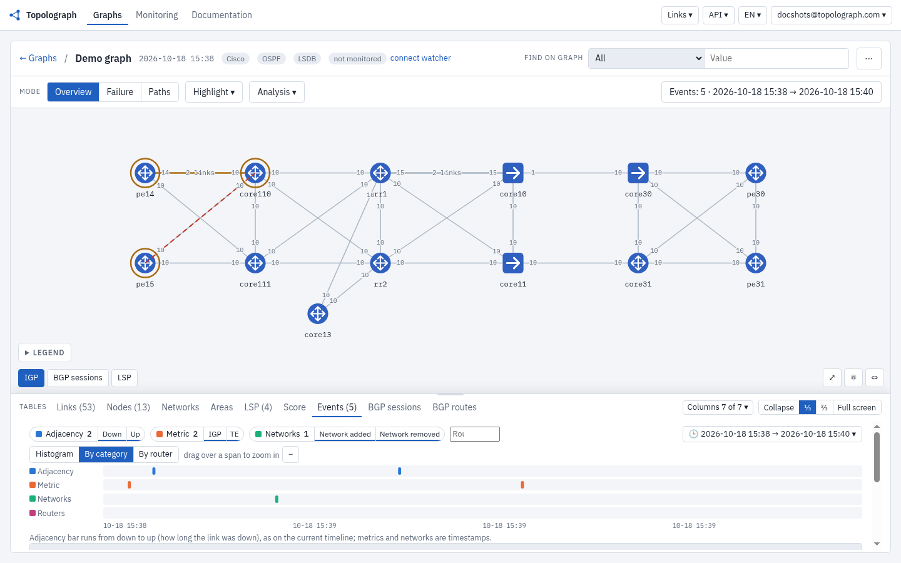
*Events on the graph and on the timeline: Graphs, open a graph, **Events** tab.*

## What you see in Topolograph
**Monitoring.** Events as a histogram by category over the period you pick, with the events table below (here: the 13-router demo, events of pe14, pe15, core31 and core10). Open **Monitoring** in the top menu.
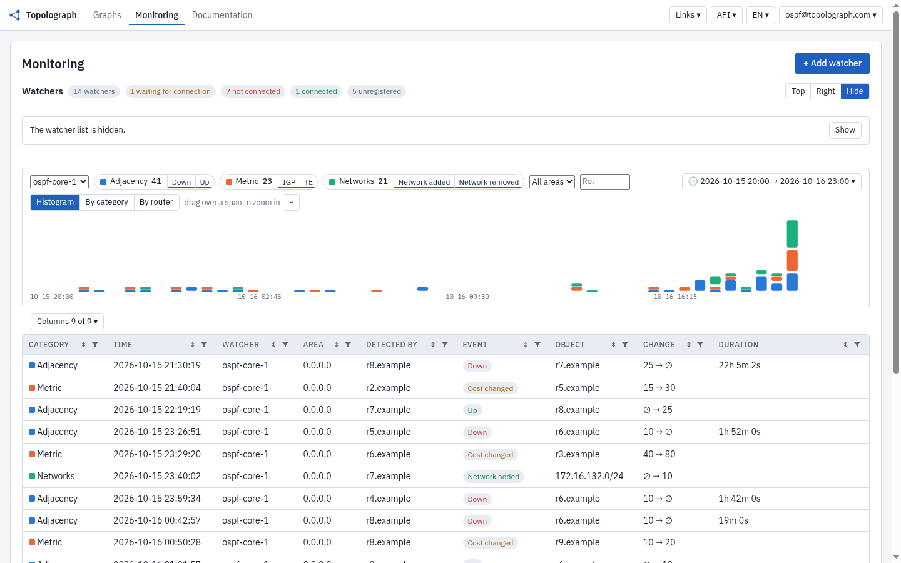

**Events by router.** The same period grouped by the router that detected the change. In a graph, open the **Events** tab and choose **By router**.
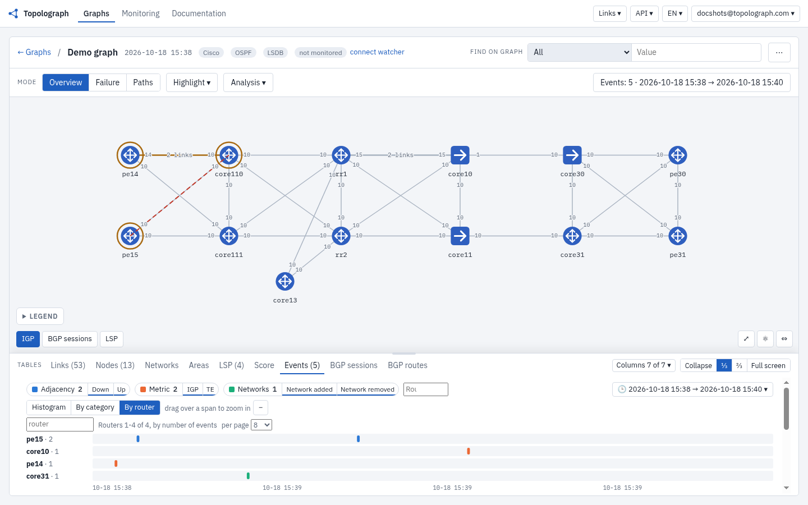

**Event search.** The events table filtered by router, event type and period. On the **Monitoring** page here: router `pe15`, adjacency down events, a chosen period.
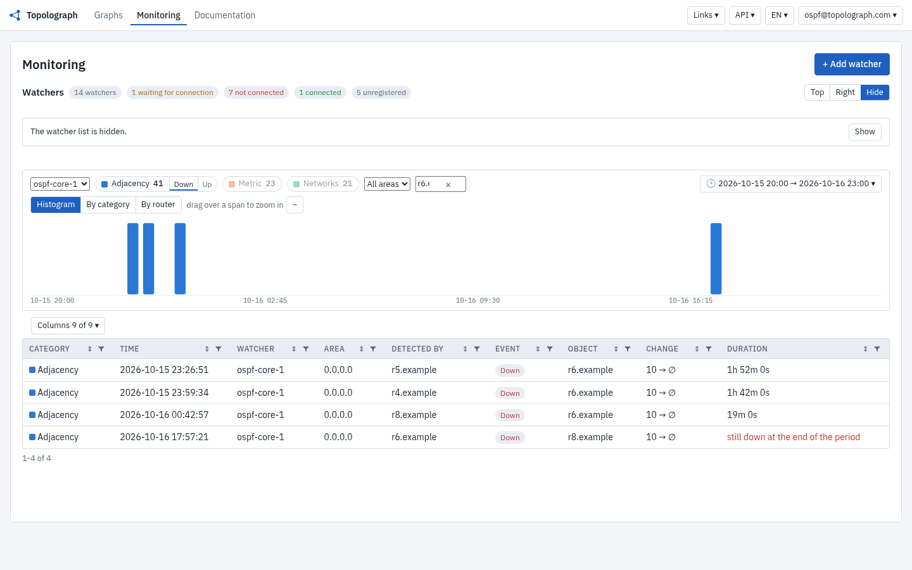

**The graph at the moment of an event.** Click an event in the **Events** tab to open the graph as it was at that time. After the adjacency down event (pe15, core110) the link between them is drawn as down. **Back to live** returns to the current graph.
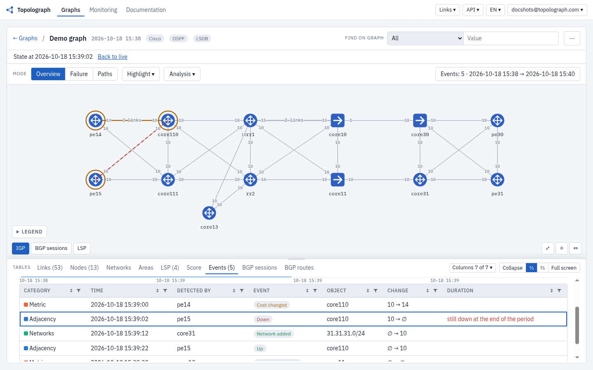

**A link cost change on the graph.** The selected event row (pe14, core110, 10 → 14) is in the **Events** tab and the changed link is highlighted on the graph: the cost between pe14 and core110 went from 10 to 14.
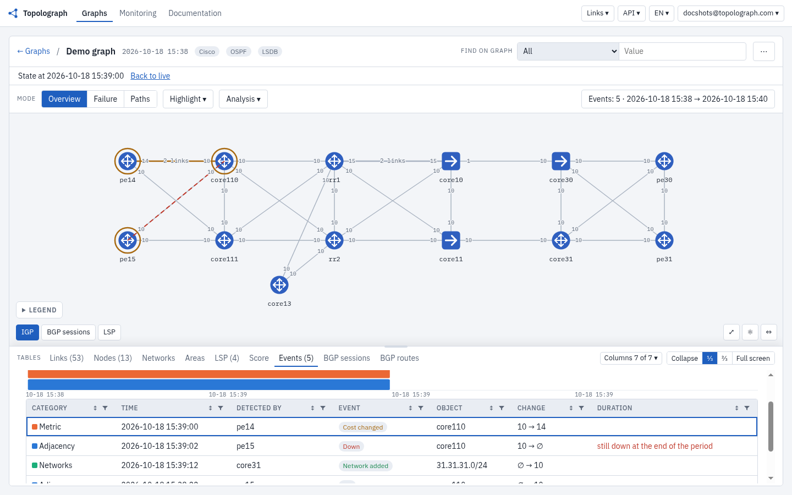

## Quick start
1. Enterprise: in Topolograph open **Add → Watcher**, choose the type (OSPF Watcher) and the mode (GRE or BGP-LS) and fill in the form. The wizard issues a watcher token and shows one install command.

    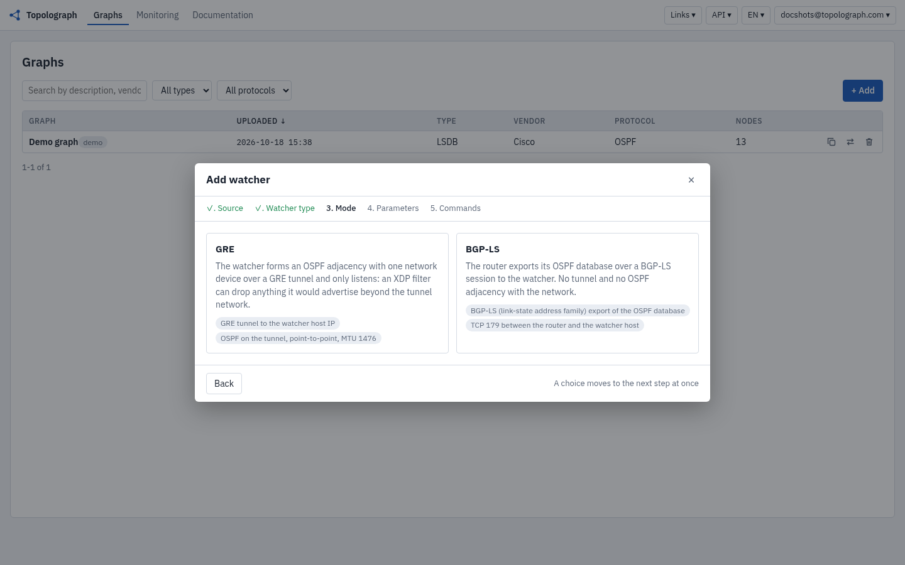

    

2. Run the command on a Docker host with containerlab. It downloads `install.sh` pinned to a release tag, checks its SHA-256 and runs it with `--url`, `--token` and `--ref`:

    ```bash
    curl -fsSLo install.sh https://raw.githubusercontent.com/Vadims06/ospfwatcher/<version>/install.sh \
      && echo "<sha256>  install.sh" | sha256sum -c \
      && sudo bash install.sh --url <topolograph-url> --token <watcher-token> --ref <version>
    ```

    `install.sh` clones this repository into `/opt/topolograph/ospfwatcher`, checks out the tag and starts `configure.sh`. The same steps by hand:

    ```bash
    # 1. Download
    [ -d /opt/topolograph/ospfwatcher ] || sudo git clone https://github.com/Vadims06/ospfwatcher /opt/topolograph/ospfwatcher
    cd /opt/topolograph/ospfwatcher && sudo git fetch --tags origin <version> && sudo git checkout --detach FETCH_HEAD
    # 2. Configure and run
    sudo ./configure.sh --url <topolograph-url> --token <watcher-token>
    ```
    `configure.sh` checks Docker, Docker Compose, containerlab, curl, git, systemd and root, fetches your answers from Topolograph, builds the watcher with the image's `render --answers` and starts it from the `topolograph-ospfwatcher` systemd service, which brings the watchers back after a reboot. All watchers of one checkout share its version: `configure.sh` rebuilds each of them from its own registration.
3. Configure the router as the watcher page shows. The page shows when the command ran, when data arrived and a link to the graph; once data arrives the watcher shows "Connected".

No events on the dashboard? Start with [Troubleshooting](#troubleshooting).

### Requirements and more watchers
1. Choose a Linux host with Docker, Docker Compose v2, [containerlab](https://containerlab.dev/install/), curl and git; GRE mode also needs iptables and conntrack.
2. Launch your own Topolograph with [topolograph-docker](https://github.com/Vadims06/topolograph-docker) or use the public https://topolograph.com.
3. To add another watcher on the same host, repeat step 1 of the Quick start: every watcher of the checkout is rebuilt from its own registration. To change answers or after **Rotate token**, run `configure.sh` again; when a newer version is out, the watcher page shows the update command.
4. Configure the network device, see [Device configuration](#device-configuration).

### Moving a watcher installed by hand
To move a watcher set up by hand to Topolograph:
1. Stop it in its old checkout with `sudo containerlab destroy -t watcher/<watcher folder>/config.yml` and move that folder out of the checkout. Two GRE watchers towards one router from one host cannot run at the same time.
2. Add it on the Monitoring page with the same answers and run the command the page shows.

The manual setup is described in [docs/exporters.md](docs/exporters.md).

### Removing a watcher
Deleting a watcher in Topolograph revokes its token; its containers keep running on the host until you stop them. To remove one watcher of an installed checkout:
```
cd /opt/topolograph/ospfwatcher
sudo onboarding/stop.sh watcher/<watcher folder>/config.yml
sudo mkdir -p watcher/.removed && sudo mv watcher/<watcher folder> watcher/.removed/
```
To remove every watcher of the host: `sudo systemctl disable --now topolograph-ospfwatcher`. Both also remove the GRE rules and connection-tracking entries that `containerlab destroy` leaves behind.

## Logged topology changes:
* OSPF neighbor adjacency Up/Down
* OSPF link cost changes
* OSPF networks appeared/disappeared from the topology
* OSPF node attribute flags:
  * ABR (Area Border Router)
  * ASBR (AS Boundary Router)
  * Max-metric / stub router (RFC 3137)
* OSPF TE attributes (via Opaque LSA / BGP-LS):
  * Administrative Group (color, resource class)
  * Maximum Link Bandwidth
  * Maximum Reservable Link Bandwidth
  * Unreserved Bandwidth
  * Traffic Engineering Default Metric
  * Shared Risk Link Group (SRLG)


## Architecture

### Connection Modes

OSPF Watcher supports two connection modes:

#### GRE Mode (Traditional)
The FRR container is isolated in an individual network namespace and establishes an OSPF adjacency over a GRE tunnel with a network device. The **announcement filter** (a tc-BPF program on the egress of `gre1`) inspects every OSPF packet the watcher sends. An LS Update passes only if it carries the watcher's own Router LSA with the tunnel network and nothing else; anything else is dropped. It prevents the network from populating by unexpected network prefixes.

#### BGP-LS Mode
The watcher connects to a network router via BGP-LS (BGP Link-State) protocol. The router must be configured to advertise OSPF topology information via BGP-LS. The watcher uses GoBGP (bgplswatcher) to establish a BGP session and receive BGP-LS updates, which are then processed by the OSPF watcher component. This mode eliminates the need for GRE tunnels and OSPF adjacencies, making it easier to deploy in environments where GRE tunnels are not feasible.

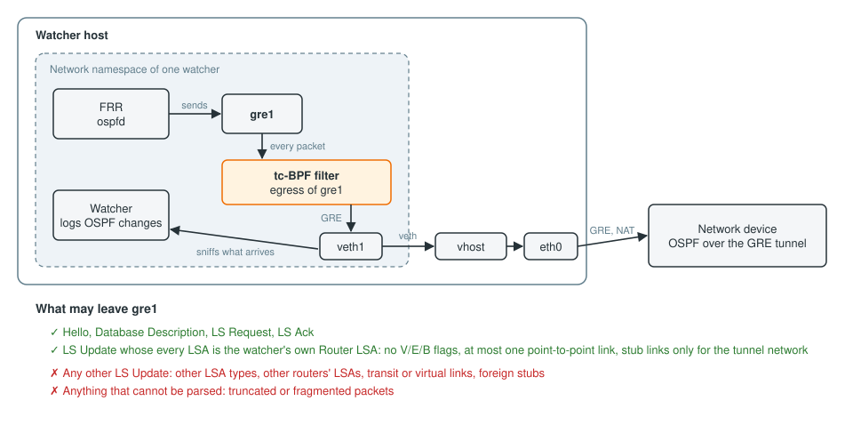  
Each Watcher instance maintains all routes and updates within an isolated network namespace. This isolation ensures efficient monitoring without interference and prevent route leaks.

> [!NOTE]
> ospfwatcher:v1.1 is compatible with [topolograph:v2.7](https://github.com/Vadims06/topolograph/releases/tag/v2.27)
> , it means that OSPF network changes can be shown on the network graph.

### Functional Role


## Demo
Instant notifications. The video and the animation below show Topolograph 2.49; the current interface is in [What you see in Topolograph](#what-you-see-in-topolograph).
[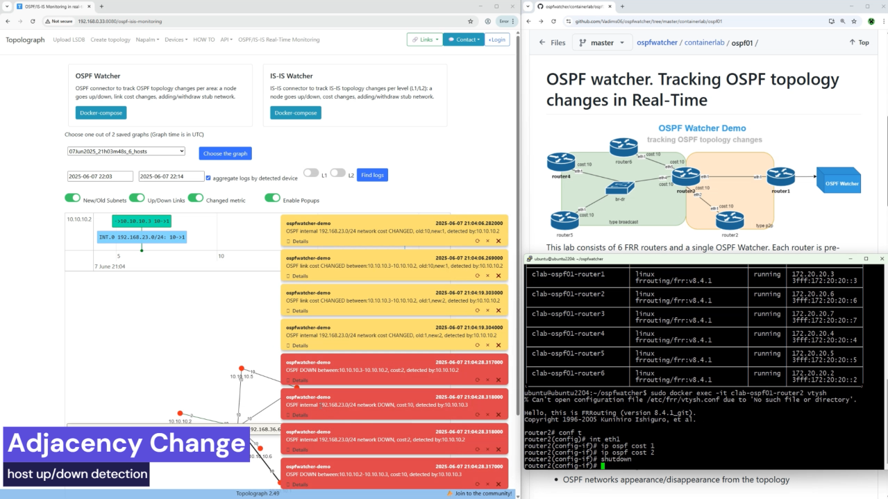](https://youtu.be/2IHbxmDVMA0)  
Click on the image in order zoom it.  


## Watcher Heartbeats

A watcher added on Topolograph's Monitoring page sends heartbeats with its own token and needs no setup.

| Status | Meaning |
|--------|---------|
| `up` | Last heartbeat received within `HEARTBEAT_INTERVAL × 3` seconds |
| `stale` | Last heartbeat older than `× 3` but within `× 6` seconds |
| `down` | No heartbeat for more than `× 6` seconds, or watcher never connected |

| Variable | Default | Description |
|----------|---------|-------------|
| `HEARTBEAT_INTERVAL` | `60` | Seconds between heartbeats. |
| `WATCHER_IP` | _(auto)_ | Override the watcher's reported source IP (`srcid`). Useful in containers where hostname resolution returns `127.0.1.1`. |


## Quick lab
#### Containerlab
Here is a lab for tracking OSPF topology changes placed here **containerlab/ospf01**. Watcher logs:  
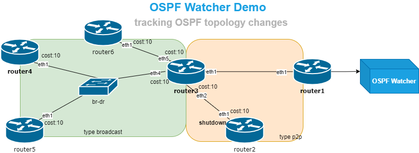    
OSPF topology changes are printed by Watcher in a text file only.
```
./containerlab/ospf01/prepare.sh
sudo clab deploy --topo ./containerlab/ospf01/ospf01.clab.yml
```   


### Device configuration
Setup GRE tunnel from the network device to the host. An example for Cisco

> [!NOTE]
> You can skip this step and run ospfwatcher in `test_mode`, so test LSDB from
> the file will be taken and test changes (loss of adjacency and change of OSPF
> metric) will be written to the watcher log.

```bash
interface gigabitether0/1
ip address <GRE tunnel ip address>
tunnel mode gre
tunnel source <router-ip>
tunnel destination <host-ip>
ip ospf network type point-to-point
```
With the manual setup, set the GRE tunnel network where <GRE tunnel ip address> is placed in `quagga/config/ospfd.conf`; the Monitoring page does it for you.  

For BGP-LS mode, export the OSPF database to the watcher. An example for Cisco IOS-XR
```bash
router ospf 1
 distribute link-state
!
router bgp <router-as>
 address-family link-state link-state
 !
 neighbor <watcher-host-ip>
  remote-as <watcher-as>
  ! for eBGP: ebgp-multihop 255
  address-family link-state link-state
```

Check OSPF neighbor, if there is no OSPF adjacency between network device and OSPF Watcher, check troubleshooting `OSPF Watcher <-> Network device connection` section below (to run diagnostic script).


### Listen-only mode. Announcement filter in action.
The watcher must only listen. A tc-BPF program on the egress of `gre1` inside the watcher's network namespace drops everything the watcher's FRR sends except its own minimal Router LSA.

| OSPF packet | Verdict |
|---|---|
| Hello, LS Request, LS Ack, Database Description, non-OSPF | pass |
| LS Update | pass only if every LSA is the watcher's own Router LSA: no V/E/B flags, at most one point-to-point link, stub links only for the GRE tunnel network |
| Any other LS Update (other LSA types, other routers' LSAs, transit or virtual links, foreign stubs, truncated or fragmented packets) | drop |

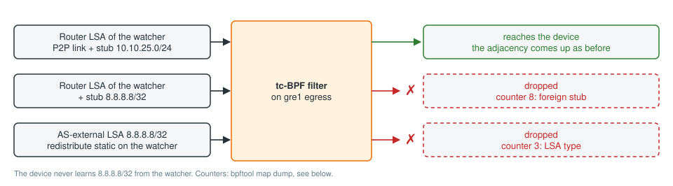  
If `8.8.8.8/32` is added to the watcher's announcement, as an extra stub network or redistributed as an external LSA, the filter drops it and the network never learns it.

To check whether the filter is attached, run
```
sudo ip netns exec <netns> tc filter show dev gre1 egress
filter protocol all pref 49152 bpf chain 0 handle 0x1 announcement_filter.o:[tc] direct-action not_in_hw id 13746 ... jited
```
`<netns>` is the watcher router's network namespace, e.g. `clab-watcher1-gre1025-ospf-router`; `sudo ip netns list` shows it.

Drop counters, one per reason, are in an array map of the attached program. Use the `id` from the output above:
```
sudo bpftool prog show id <id>                # map_ids <map id>
sudo bpftool map dump id <map id>             # key = reason, value = dropped packets
```
Keys: 0 malformed, 1 fragment, 2 LSA count, 3 LSA type, 4 LSA origin, 5 LSA flags, 6 LSA length, 7 link type, 8 foreign stub, 9 P2P link count.

To enable or disable the filter, set `is_filter_enabled` in the watcher's answers (on its Topolograph page, or in your answers file) and run `configure.sh` or `render` again, then re-create the watcher's lab.

##### Known limits
* The watcher forwards nothing but its own Router LSA, so a network device that rebooted cannot get other routers' LSAs from the watcher. It resynchronises with its other neighbors.
* Each watcher's router id is pinned in its FRR config (`ospf router-id`, the watcher's GRE tunnel address) and compiled into the filter; `render` adds it to a watcher created earlier.
* Needs kernel 5.4 or newer. Tested only on 5.15.
* The filter is off by default (manifest default false).
* With the filter on, the filter node itself brings `gre1` up after attaching, and the `h2` node is not created. If the filter cannot attach, `gre1` stays down: no filter means no adjacency. Fix the cause or set `is_filter_enabled` to false and render again.


## Troubleshooting
Start on the watcher's page in Topolograph (**Monitoring**, then the watcher): it shows which step is missing: the install command ran, data arrived, the graph exists.

On the watcher host an installed watcher lives in `/opt/topolograph/ospfwatcher`:
* `sudo systemctl status topolograph-ospfwatcher` shows whether the watchers started.
* `sudo docker logs ospf-fluent-bit` shows delivery to Topolograph. `401` means the watcher's token was rotated: run the command from its watcher page again. A deleted watcher gets `401` too: remove it from the host, see [Removing a watcher](#removing-a-watcher). `403` means the event names a graph that does not belong to this watcher.

##### Symptoms
Network changes are not tracked: the watcher log `watcher/logs/watcher<num>-...log` (under `/opt/topolograph/ospfwatcher` for an installed watcher) stays empty. `<num>` is the number in the watcher's folder name: `ls /opt/topolograph/ospfwatcher/watcher/`.

##### Steps:
1. Run the diagnostic. It checks the **OSPF Watcher** <-> **Network device** connection: GRE and OSPF hellos from both ends, MTU, stale conntrack entries and the iptables rules on the watcher's path. For a rule that is wrong it prints the command to fix it.

    ```
    cd /opt/topolograph/ospfwatcher && sudo onboarding/diagnostic.sh <num>
    ```
    The script passes `iptables-save -c` to `docker run -i --rm -v ./:/home/watcher/watcher/ --network host vadims06/ospf-watcher:$(cat VERSION) diagnostic --watcher_num <num> --iptables-save -`.
2. Login on FRR.

    ```
    sudo docker exec -it watcher#-gre#-ospf-router vtysh
    ```
    `show ip ospf neighbor` should show network device as a neighbor in the output.

**For BGP-LS Mode:**

1. Check `bgplswatcher` container logs:

    ```bash
    sudo docker logs watcher<num>-bgpls-ospf-bgplswatcher
    ```

    OSPF Watcher posts topology to Topolograph after BGP session establishment via BGP-LS.

2. Verify BGP session is established using `gobgp` CLI:

    ```bash
    # List all BGP neighbors with session status
    docker exec -it watcher<num>-bgpls-ospf-bgplswatcher gobgp neighbor
    
    # Show detailed status for a specific neighbor
    docker exec -it watcher<num>-bgpls-ospf-bgplswatcher gobgp neighbor <neighbor-ip-address>
    
    # Check routes received from a neighbor (BGP-LS address family)
    docker exec -it watcher<num>-bgpls-ospf-bgplswatcher gobgp neighbor <neighbor-ip> adj-in -a ls
    
    # Check global RIB (accepted routes)
    docker exec -it watcher<num>-bgpls-ospf-bgplswatcher gobgp global rib -a ls
    ```

    The `gobgp neighbor` command shows:

    - **Peer**: Neighbor IP address  
    - **AS**: Remote AS number  
    - **Up/Down**: Session uptime  
    - **State**: Session state (`Establ` = Established, `Idle`, `Connect`, `Active`, etc.)  
    - **#Received**: Number of routes received  
    - **Accepted**: Number of routes accepted  

    > Run `sudo sysctl -w net.ipv4.ip_unprivileged_port_start=0` on the Linux host to allow GoBGP on port 179 if needed to start goBGP in passive mode.

##### Symptoms
The watcher log has changes, but Topolograph shows no events.
##### Steps:
The chain is: FRR (GRE mode) or bgplswatcher (BGP-LS mode) -> Watcher -> Fluent Bit -> Topolograph.
1. Check that the watcher log has the change, as in the previous case:
    ```
    2024-07-22T20:24:08Z,watcher-local,network,8.8.0.60/30,changed,old_cost:12,new_cost:-1,10.10.10.5,01Jan2023_00h00m00s_7_hosts,0.0.0.0,65001,external,1
    ```
2. Check that `ospf-fluent-bit` is running (`sudo docker ps`) and that its logs show no `401` or `403` (see above).

For a watcher that feeds ELK, Zabbix, Loki or webhooks through Logstash, see [Troubleshooting Logstash](docs/exporters.md#troubleshooting-logstash).

### Topolograph suite
* OSPF Watcher [link](https://github.com/Vadims06/ospfwatcher)
* IS-IS Watcher [link](https://github.com/Vadims06/isiswatcher)
* Topolograph [link](https://github.com/Vadims06/topolograph)
* Topolograph in docker [link](https://github.com/Vadims06/topolograph-docker)

### Community & feedback
* https://t.me/topolograph
* admin at topolograph.com

### License
 GPL-3.0 license

[Other exports (ELK, Zabbix, Loki, webhooks)](docs/exporters.md)

> Watchers that feed Topolograph are an **Enterprise** feature; Community Topolograph has no watchers. Editions and contact: https://topolograph.com/#editions.
