# OSPF Topology Watcher
OSPF Watcher logs OSPF topology changes for network engineers: adjacencies, link costs, networks, node flags and TE attributes. It listens to the OSPF control plane passively, in one of three connection modes (GRE, Pure L2 (macvlan) or BGP-LS), and sends every change to Topolograph. There you see the change on the network graph and keep the history of events.

## Quick start: a watcher on topolograph.com
Watchers with live events and event history run on [topolograph.com](https://topolograph.com). They are free.

1. Sign in, open **Monitoring** and press **+ Add watcher**.
2. Choose **OSPF Watcher**, the connection mode, and fill in the parameters.
3. Run the command the page shows on a Linux x86_64 host. It downloads the watcher, checks its SHA-256 and starts it with a one-time code. The code works once, within 10 minutes.
4. Configure the router from the example on the same page. The watcher turns **connected** on the Monitoring page, and its **Last event** follows new events.

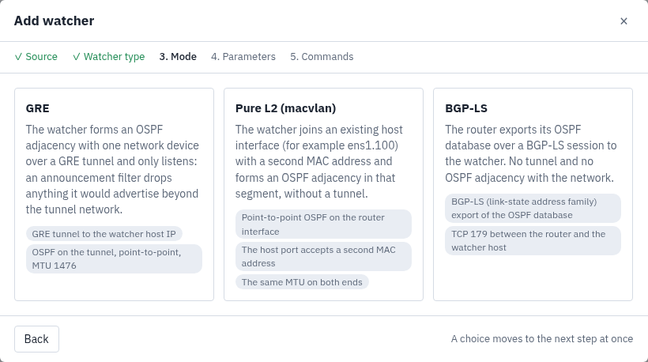 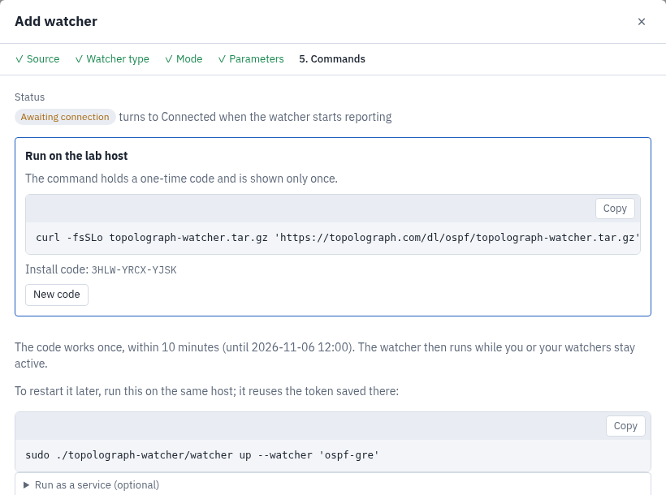

| Mode | How the watcher joins | Router | Watcher host | Demo |
|---|---|---|---|---|
| GRE | OSPF adjacency over a GRE tunnel. A filter drops any announcement beyond the tunnel network. | GRE tunnel to the host, OSPF point-to-point on it | `ip_gre` module, GRE (IP protocol 47) from the router allowed in | [video](https://topolograph.com/videos/1-ospf-gre.mp4) |
| Pure L2 (macvlan) | A second MAC on an existing host interface, for example `ens192.100`, and an OSPF adjacency on that segment. No tunnel. The filter is always on. | OSPF point-to-point on the interface in that segment, the same MTU | `macvlan` module; the switch or hypervisor port accepts a second MAC; one watcher per host interface | [video](https://topolograph.com/videos/3-ospf-macvlan.mp4) |
| BGP-LS | The router exports its OSPF database over BGP-LS. No tunnel, no OSPF adjacency. | BGP-LS (link-state address family) to the host | TCP 179 between the host and the router | [video](https://topolograph.com/videos/6-ospf-bgpls.mp4) |

A watcher works together with Topolograph: it sends its data there and stops when Topolograph is unreachable or its token has ended.

### Topolograph OSPF Monitoring
The watcher row shows its last event, the histogram and the table below show every event.
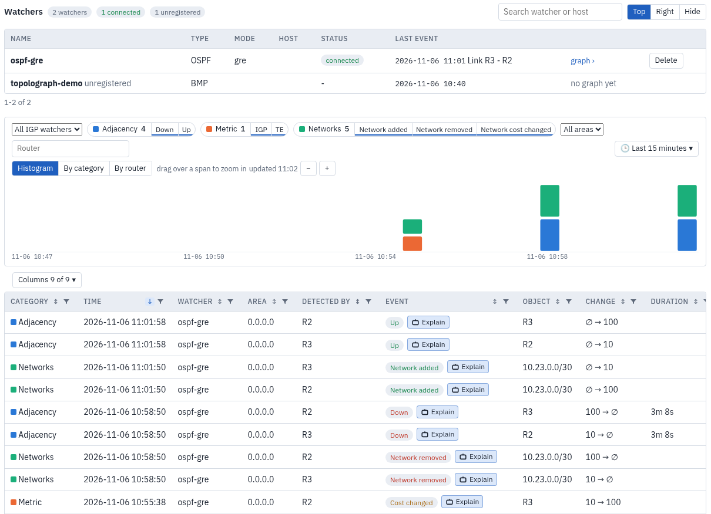

### Topolograph: the graph at the moment of an event
Click an event to open the graph as it was at that time. The moment strip steps between events.
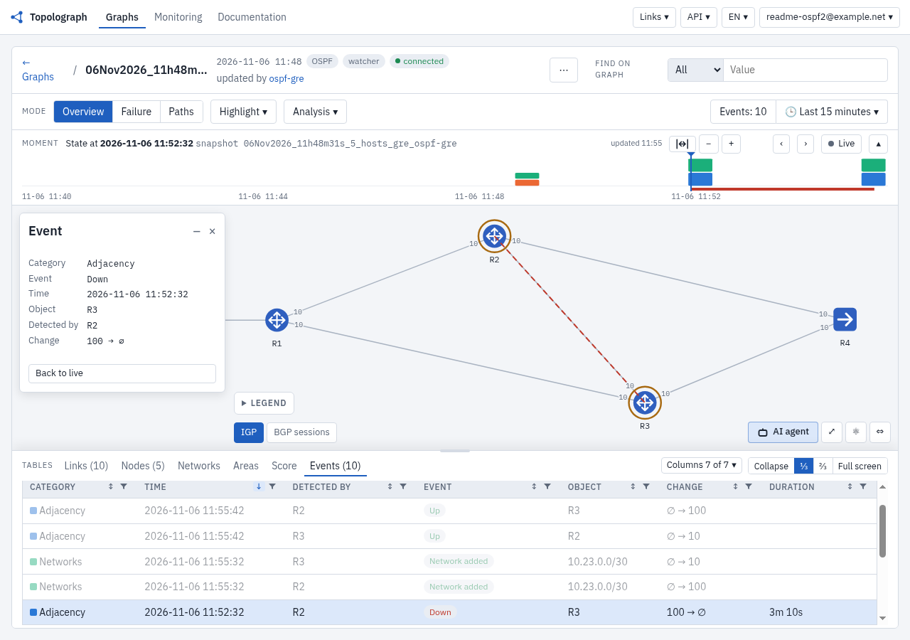

A cost change: the link shows the new cost, and the Moment strip above and the Events table below point to the same event.
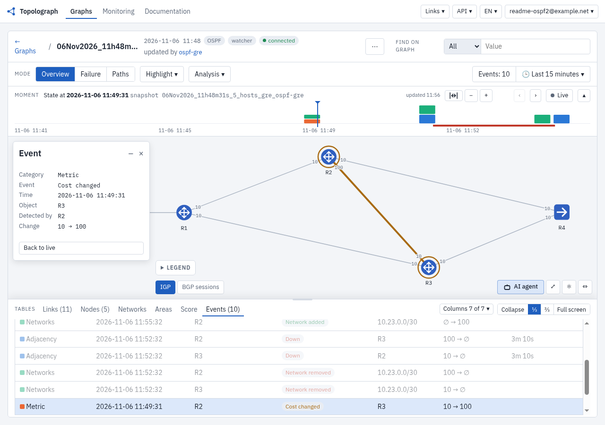

No events on the dashboard? Start with [Troubleshooting](#troubleshooting).

The self-hosted Topolograph from [topolograph-docker](https://github.com/Vadims06/topolograph-docker) takes no OSPF watcher data. To see events in Topolograph, start the watcher on topolograph.com.

## Logged topology changes:
* OSPF neighbor adjacency Up/Down
* OSPF link cost changes
* OSPF networks appeared/disappeared from the topology
* OSPF node attribute flags:
  * ABR (Area Border Router)
  * ASBR (AS Boundary Router)
  * Max-metric / stub router (RFC 6987)
* OSPF TE attributes (via Opaque LSA / BGP-LS):
  * Administrative Group (color, resource class)
  * Maximum Link Bandwidth
  * Maximum Reservable Link Bandwidth
  * Unreserved Bandwidth
  * Traffic Engineering Default Metric
  * Shared Risk Link Group (SRLG)

## Architecture

### Connection Modes
OSPF Watcher joins the network in one of three ways:

* **GRE.** The router and the watcher host build a GRE tunnel. The watcher runs FRR's OSPF daemon in its own network namespace and forms a point-to-point OSPF adjacency over the tunnel, so it receives every LSA flooded in the area.
* **Pure L2 (macvlan).** The same, without a tunnel: a second MAC address on an existing host interface, for example the VLAN interface `ens192.100`, places the watcher on a router's segment.
* **BGP-LS.** The router exports its OSPF database to the watcher over a BGP-LS session (TCP 179). There is no tunnel and no OSPF adjacency.

In Pure L2 mode, and in GRE mode unless you turn it off, an eBPF filter on the watcher's interface lets out only the watcher's own minimal Router LSA, so the watcher never announces networks into your OSPF domain. In these two modes each watcher has its own network namespace, so several watchers on one host do not see each other's routes. In BGP-LS mode the watcher is itself the BGP-LS speaker and needs no namespace or FRR.

The watcher keeps the link-state database and derives each change from the database before and after an LSA arrives. Changes go to Topolograph only; the watcher does not write them to a local file.

### Announcement filter in action
If the watcher's OSPF ever announces more than its own minimal Router LSA, the filter drops that LS Update before it leaves the watcher. Only LS Update packets are inspected; Hello, DB Description, LS Request and LS Ack pass unchanged. The diagram shows what the watcher's ospfd sends (left) and what leaves the tunnel toward the router (right); the numbers mark where each piece of evidence below was taken.

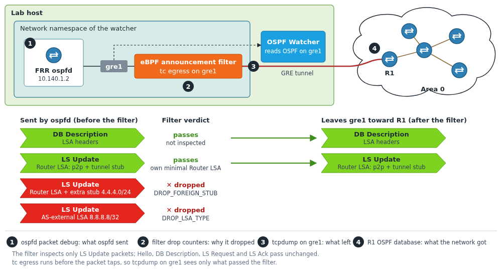

`8.8.8.8/32` was redistributed on the watcher, so its ospfd originated an AS-external LSA. The filter dropped it, and R1 has no `8.8.8.8`. Redistribution also sets the ASBR flag on the watcher's Router LSA, so that LSA is held back too; R1 keeps the previous one.

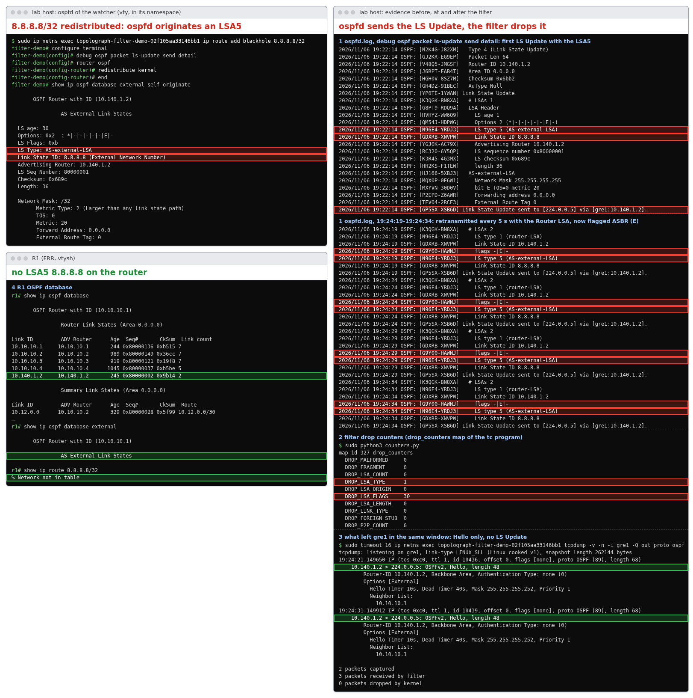

The same applies to an extra stub network in the Router LSA: R1 keeps the earlier Router LSA with the tunnel stub only.

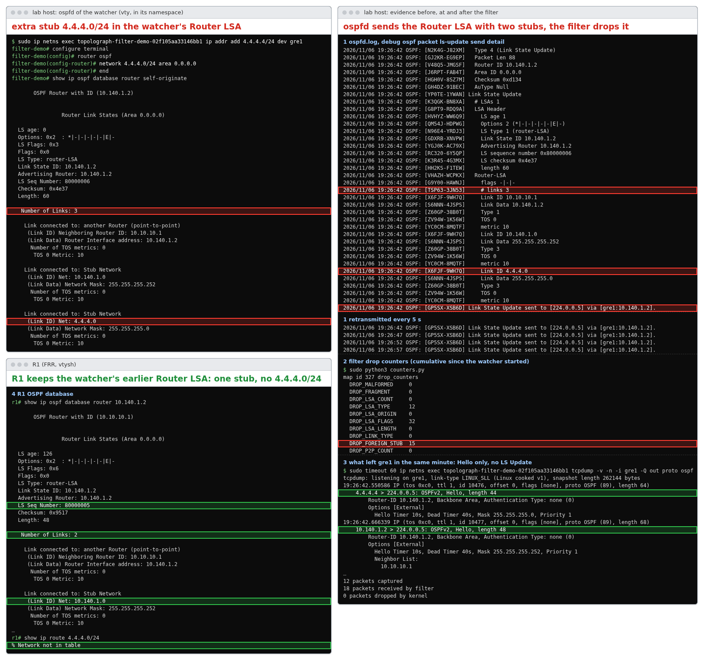

On start the watcher prints `Announcement filter is attached to <interface>: only the watcher's own minimal Router LSA can leave`, or `Announcement filter is off for this watcher`.

Demo video of the filter (watcher 3.x, XDP version):

<a href="https://www.youtube.com/watch?v=mC4PVD5hrRU">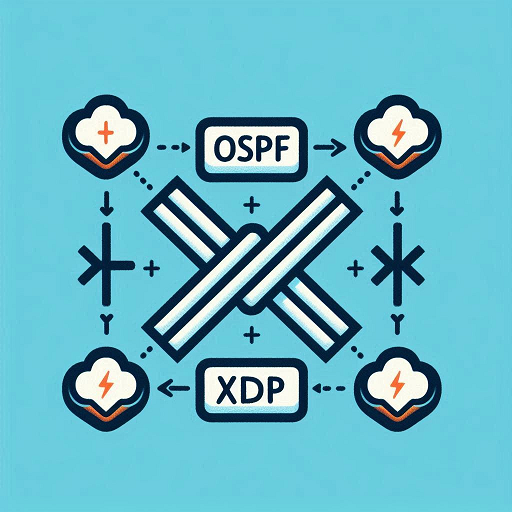</a>

### Functional Role
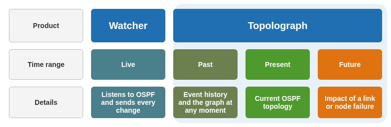

## Demo
A short video for each connection mode is linked in the table in [Quick start](#quick-start-a-watcher-on-topolographcom).

## Router configuration
The **+ Add watcher** page shows the router configuration for the mode you picked, with your addresses filled in. The examples below show the same with placeholders.

### GRE
The router needs a GRE tunnel to the watcher host and OSPF point-to-point on it, MTU 1476.

FRR (Linux shell of the router, then vtysh):
```
ip tunnel add gre1025 mode gre local <router-ip> remote <watcher-host-ip> ttl 255
ip addr add <tunnel-ip-on-router>/30 dev gre1025
ip link set gre1025 up

interface gre1025
 ip ospf area <area>
 ip ospf network point-to-point
```
Cisco IOS-XR:
```
interface tunnel-ip1025
 ipv4 address <tunnel-ip-on-router> 255.255.255.252
 tunnel source <router-ip>
 tunnel destination <watcher-host-ip>
!
router ospf 1
 area <area>
  interface tunnel-ip1025
   network point-to-point
```

### Pure L2 (macvlan)
The router interface sits in the same L2 segment as the watcher host's interface, runs OSPF point-to-point and has the same MTU. The switch or hypervisor port must accept the watcher's extra MAC address (on VMware: promiscuous mode or forged transmits).

FRR:
```
interface <interface-to-watcher-segment>
 ip address <address in the watcher's subnet>
 ip ospf area <area>
 ip ospf network point-to-point
```
Cisco IOS-XR:
```
interface <interface-to-watcher-segment>
 ipv4 address <address in the watcher's subnet>
!
router ospf 1
 area <area>
  interface <interface-to-watcher-segment>
   network point-to-point
```

### BGP-LS
The router exports its OSPF database over BGP-LS. TCP 179 must be open between the router and the watcher host.

Cisco IOS-XR:
```
router ospf 1
 distribute link-state
!
router bgp <router-as>
 address-family link-state link-state
 !
 neighbor <watcher-host-ip>
  remote-as <watcher-as>
  ! for eBGP: ebgp-multihop 255
  address-family link-state link-state
```

## Watcher host
* Linux x86_64 host with sudo
* iproute2 (`ip`, and `tc` when the announcement filter is on)
* GRE mode: the `ip_gre` kernel module; the host firewall allows GRE packets (IP protocol 47) from the router
* Pure L2 mode: the `macvlan` kernel module, Linux kernel 5.4 or newer; the parent interface, for example `ens192.100`, is in the router's L2 segment
* Access to topolograph.com over HTTPS

The watcher needs no Docker and no FRR install: the bundle carries the FRR daemons it runs. When it stops, it removes its namespace, tunnel or macvlan interface.

## Run, restart, stop
* The first start uses the command from the **+ Add watcher** page with its one-time code.
* Restart with the saved token: `sudo ./topolograph-watcher/watcher up --watcher <name>`.
* Stop with Ctrl-C. The watcher also stops by itself when its token ends or is refused, or when it cannot reach Topolograph for longer than its lease.

## Troubleshooting
The watcher prints what it waits for. Typical lines:

* `FRR does not have any neighbors, please set up the GRE tunnel or the L2 segment and build OSPF adjacency first.` The adjacency is not up yet. On the router, check the tunnel or the segment and `show ip ospf neighbor`. In GRE mode, check that the host firewall lets GRE (IP protocol 47) in from the router.
* `FRR does not report an OSPF area yet, please enable OSPF on the GRE or L2 interface.` OSPF is not enabled on the router's side of the tunnel or segment.
* `POST https://topolograph.com, Status: 200` The topology reached Topolograph. The watcher shows **connected** on the Monitoring page.
* The watcher exits saying the token ended or was refused. Start it again from the **+ Add watcher** page with a new one-time code.

## Other integrations
These integrations have been used with OSPF Watcher 3.x and its docker compose setup, described in the [3.3.0 README](https://github.com/Vadims06/ospfwatcher/blob/v3.3.0/README.md). Watcher 4.0.0 sends events to Topolograph only.

* **Kibana**: browse and filter OSPF topology change logs, build dashboards.

  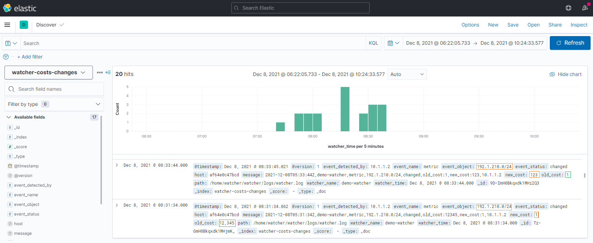

  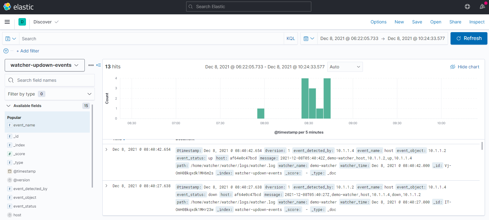

* **Zabbix**: alarms on OSPF adjacency, link cost and network changes.

  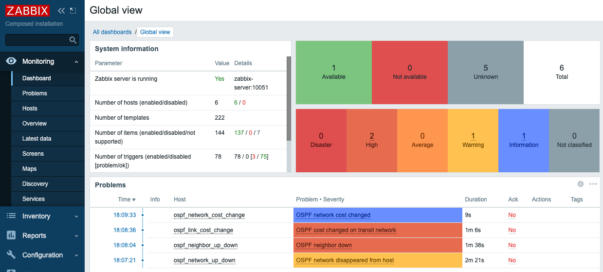

* **Loki / Grafana**: OSPF topology changes as log streams with labels, for Grafana queries.
* **WebHook**: push each change to an HTTP endpoint, for example a Slack channel.

  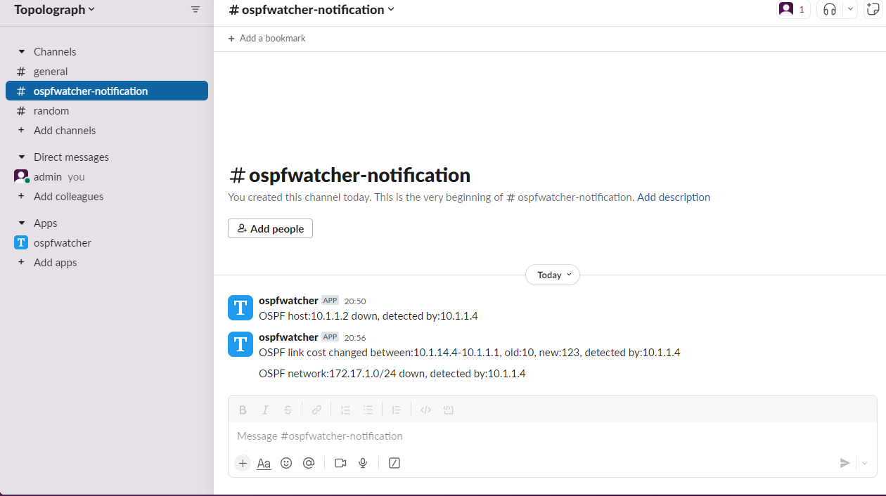

### Topolograph suite
* OSPF Watcher [link](https://github.com/Vadims06/ospfwatcher)
* IS-IS Watcher [link](https://github.com/Vadims06/isiswatcher)
* Topolograph [link](https://github.com/Vadims06/topolograph)
* BMP Watcher [link](https://github.com/Vadims06/bmpwatcher)
* Topolograph in docker [link](https://github.com/Vadims06/topolograph-docker)

### Feedback
* https://t.me/topolograph
* admin at topolograph.com

### License
The source in this repository is under the GPL-3.0 license. The watcher bundle ships its own licence, `topolograph-watcher/licenses/EULA.md`, and the licences of the FRR and other components it carries.  
