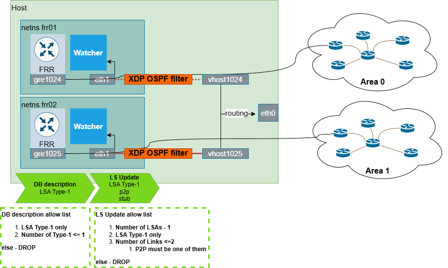
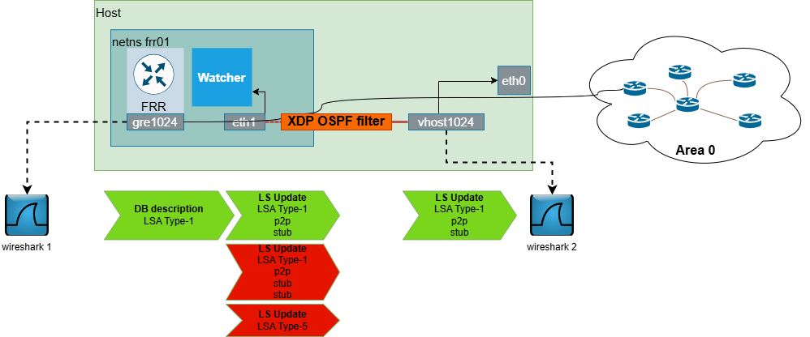
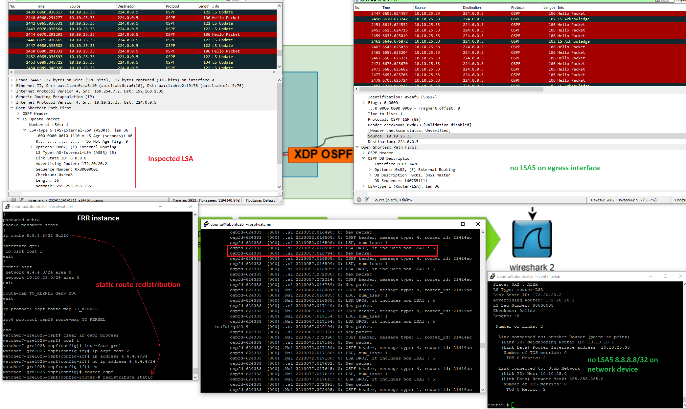
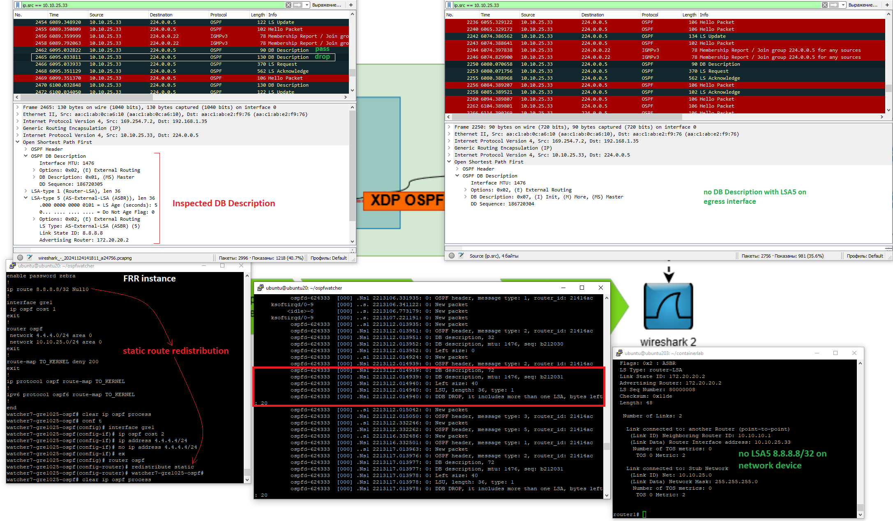
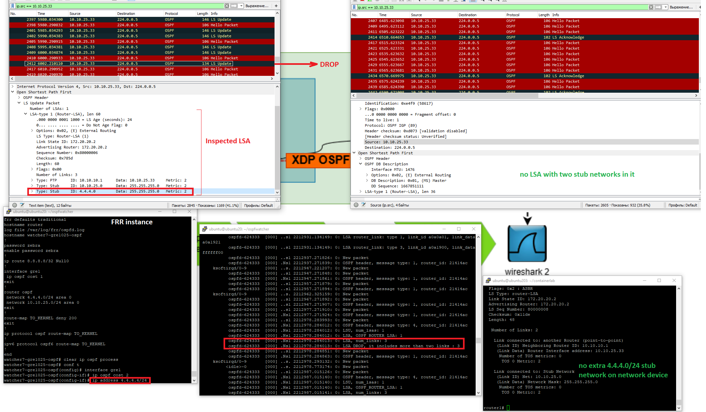
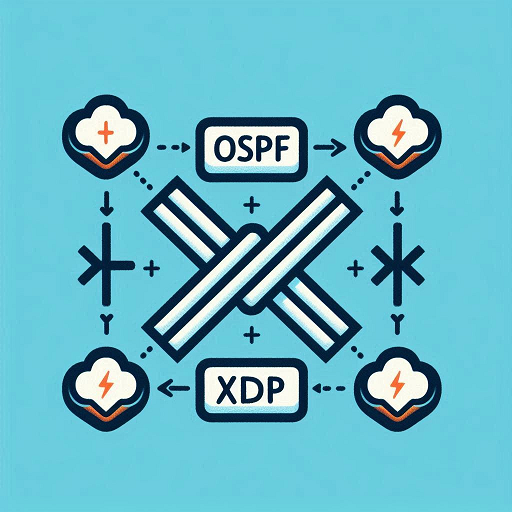

# OSPF Topology Watcher
OSPF Watcher streams OSPF topology changes into Topolograph: every adjacency, cost and prefix change appears on the graph and on its timeline.

> [!NOTE]
> Watchers that feed Topolograph are an **Enterprise** feature; Community Topolograph has no watchers. Editions and contact: https://topolograph.com/#editions.

> [!NOTE]
> Tracking OSPF topology changes via **BGP-LS** is **supported starting from Docker image `vadims06/ospf-watcher:v3.1.0`**.
> For older images, BGP-LS support is not available.


*Events on the graph and on the timeline: Graphs, open a graph, **Events** tab.*

## What you see in Topolograph
**Monitoring.** Events as a histogram by category over the period you pick, with the events table below (here: the 13-router demo, events of pe14, pe15, core31 and core10). Open **Monitoring** in the top menu.


**Events by router.** The same period grouped by the router that detected the change. In a graph, open the **Events** tab and choose **By router**.


**Event search.** The events table filtered by router, event type and period. On the **Monitoring** page here: router `pe15`, adjacency down events, a chosen period.


**The graph at the moment of an event.** Click an event in the **Events** tab to open the graph as it was at that time. After the adjacency down event (pe15, core110) the link between them is drawn as down. **Back to live** returns to the current graph.


**A link cost change on the graph.** The selected event row (pe14, core110, 10 → 14) is in the **Events** tab and the changed link is highlighted on the graph: the cost between pe14 and core110 went from 10 to 14.


## Quick start
1. Enterprise: in Topolograph open **Add → Watcher**, choose the type (OSPF Watcher) and the mode (GRE or BGP-LS) and fill in the form. The wizard issues a watcher token and shows one install command.

    

    

2. Run the command on a Docker host with containerlab. It downloads `install.sh` pinned to a release tag, checks its SHA-256 and runs it with `--url`, `--token` and `--ref`:

    ```bash
    curl -fsSLo install.sh https://raw.githubusercontent.com/Vadims06/ospfwatcher/<version>/install.sh \
      && echo "<sha256>  install.sh" | sha256sum -c \
      && sudo bash install.sh --url <topolograph-url> --token <watcher-token> --ref <version>
    ```

    `install.sh` clones this repository into `/opt/topolograph/ospfwatcher`, checks out the tag and starts `configure.sh`. The same steps by hand:

    ```bash
    # 1. Download
    [ -d /opt/topolograph/ospfwatcher ] || sudo git clone https://github.com/Vadims06/ospfwatcher /opt/topolograph/ospfwatcher
    cd /opt/topolograph/ospfwatcher && sudo git fetch --tags origin <version> && sudo git checkout --detach FETCH_HEAD
    # 2. Configure and run
    sudo ./configure.sh --url <topolograph-url> --token <watcher-token>
    ```
    `configure.sh` checks Docker, Docker Compose, containerlab, curl, git, systemd and root, fetches your answers from Topolograph, builds the watcher with `client.py --answers` and starts it from the `topolograph-ospfwatcher` systemd service, which brings the watchers back after a reboot. All watchers of one checkout share its version: `configure.sh` rebuilds each of them from its own registration.
3. Configure the router as the watcher page shows. The page shows when the command ran, when data arrived and a link to the graph; once data arrives the watcher shows "Connected".

No events on the dashboard? Start with [Troubleshooting](#troubleshooting).

### Requirements and more watchers
1. Choose a Linux host with Docker, Docker Compose v2, [containerlab](https://containerlab.dev/install/), curl and git; GRE mode also needs iptables and conntrack.
2. Launch your own Topolograph with [topolograph-docker](https://github.com/Vadims06/topolograph-docker) or use the public https://topolograph.com.
3. To add another watcher on the same host, repeat step 1 of the Quick start: every watcher of the checkout is rebuilt from its own registration. To change answers or after **Rotate token**, run `configure.sh` again; when a newer version is out, the watcher page shows the update command.
4. Configure the network device, see [Device configuration](#device-configuration).

### Moving a watcher installed by hand
To move a watcher set up by hand to Topolograph:
1. Stop it in its old checkout with `sudo containerlab destroy -t watcher/<watcher folder>/config.yml` and move that folder out of the checkout. Two GRE watchers towards one router from one host cannot run at the same time.
2. Add it on the Monitoring page with the same answers and run the command the page shows.

The manual setup is described in [docs/exporters.md](docs/exporters.md).

## Logged topology changes:
* OSPF neighbor adjacency Up/Down
* OSPF link cost changes
* OSPF networks appeared/disappeared from the topology
* OSPF node attribute flags:
  * ABR (Area Border Router)
  * ASBR (AS Boundary Router)
  * Max-metric / stub router (RFC 3137)
* OSPF TE attributes (via Opaque LSA / BGP-LS):
  * Administrative Group (color, resource class)
  * Maximum Link Bandwidth
  * Maximum Reservable Link Bandwidth
  * Unreserved Bandwidth
  * Traffic Engineering Default Metric
  * Shared Risk Link Group (SRLG)


## Architecture

### Connection Modes

OSPF Watcher supports two connection modes:

#### GRE Mode (Traditional)
The FRR container is isolated in an individual network namespace and establishes an OSPF adjacency over a GRE tunnel with a network device. The **XDP OSPF filter** inspects all outgoing OSPF advertisements. It checks if FRR instance advertises only locally connected network (assigned on GRE tunnel) and no more. If it advertises multiple networks, OSPF Database description (DB) or LSUpdate will be dropped. It prevents the network from populating by unexpected network prefixes.

#### BGP-LS Mode
The watcher connects to a network router via BGP-LS (BGP Link-State) protocol. The router must be configured to advertise OSPF topology information via BGP-LS. The watcher uses GoBGP (bgplswatcher) to establish a BGP session and receive BGP-LS updates, which are then processed by the OSPF watcher component. This mode eliminates the need for GRE tunnels and OSPF adjacencies, making it easier to deploy in environments where GRE tunnels are not feasible.

  
Each Watcher instance maintains all routes and updates within an isolated network namespace. This isolation ensures efficient monitoring without interference and prevent route leaks.

> [!NOTE]
> ospfwatcher:v1.1 is compatible with [topolograph:v2.7](https://github.com/Vadims06/topolograph/releases/tag/v2.27)
> , it means that OSPF network changes can be shown on the network graph.

### Functional Role


## Demo
Instant notifications   
[](https://youtu.be/2IHbxmDVMA0)  
Click on the image in order zoom it.  


## Watcher Heartbeats

A watcher added on Topolograph's Monitoring page sends heartbeats with its own token and needs no setup.

| Status | Meaning |
|--------|---------|
| `up` | Last heartbeat received within `HEARTBEAT_INTERVAL × 3` seconds |
| `stale` | Last heartbeat older than `× 3` but within `× 6` seconds |
| `down` | No heartbeat for more than `× 6` seconds, or watcher never connected |

| Variable | Default | Description |
|----------|---------|-------------|
| `HEARTBEAT_INTERVAL` | `60` | Seconds between heartbeats. |
| `WATCHER_IP` | _(auto)_ | Override the watcher's reported source IP (`srcid`). Useful in containers where hostname resolution returns `127.0.1.1`. |


## Quick lab
#### Containerlab
Here is a lab for tracking OSPF topology changes placed here **containerlab/ospf01**. Watcher logs:  
    
OSPF topology changes are printed by Watcher in a text file only.
```
./containerlab/ospf01/prepare.sh
sudo clab deploy --topo ./containerlab/ospf01/ospf01.clab.yml
```   


### Device configuration
Setup GRE tunnel from the network device to the host. An example for Cisco

> [!NOTE]
> You can skip this step and run ospfwatcher in `test_mode`, so test LSDB from
> the file will be taken and test changes (loss of adjacency and change of OSPF
> metric) will be posted in ELK.

```bash
interface gigabitether0/1
ip address <GRE tunnel ip address>
tunnel mode gre
tunnel source <router-ip>
tunnel destination <host-ip>
ip ospf network type point-to-point
```
With the manual setup, set the GRE tunnel network where <GRE tunnel ip address> is placed in `quagga/config/ospfd.conf`; the Monitoring page does it for you.  

For BGP-LS mode, export the OSPF database to the watcher. An example for Cisco IOS-XR
```bash
router ospf 1
 distribute link-state
!
router bgp <router-as>
 address-family link-state link-state
 !
 neighbor <watcher-host-ip>
  remote-as <watcher-as>
  ! for eBGP: ebgp-multihop 255
  address-family link-state link-state
```

Check OSPF neighbor, if there is no OSPF adjacency between network device and OSPF Watcher, check troubleshooting `OSPF Watcher <-> Network device connection` section below (to run diagnostic script).


### Listen-only mode. XDP in action.
If for some reason an extra network is advertised from Watcher, this announcement will be dropped.  
Lab schema: there are two wireshark sessions on the interfaces before (on the left side) and after (on the right side) XDP filter. 
  
This examples shows that `8.8.8.8` prefix was redistributed on Watcher and added into its announcement, but it was dropped by XDP and eventually didn't reach the network.
  
The same logic is applied on Database Description messages
 
and for extra stub networks in LSA1 Update
 
To check XDP logs, run
```
sudo cat /sys/kernel/debug/tracing/trace_pipe
```
To check whether XDP filter is assigned on the interface, run
```
ubuntu20:~/ospfwatcher$ ip l show dev ospf1-gre1025
178: ospf1-gre1025@if177: <BROADCAST,MULTICAST,UP,LOWER_UP> mtu 1500 xdp qdisc noqueue state UP mode DEFAULT group default
    link/ether aa:c1:ab:e3:cb:d9 brd ff:ff:ff:ff:ff:ff link-netnsid 0
    prog/xdp id 153 <-- !!!
```
Demo video
[](https://www.youtube.com/watch?v=mC4PVD5hrRU)

To enable/disable XDP
```
sudo docker run -it --rm -v ./:/home/watcher/watcher/ --cap-add=NET_ADMIN -u root --network host vadims06/ospf-watcher:latest python3 ./client.py --action enable_xdp --watcher_num <num>
```
##### Support
Currently XDP was tested on Ubuntu 18,20 Kernel 5.4.0-204-generic.
If you faced with XDP errors - skip it while generating config file or use `--action disable_xdp` as it mentioned in the example above.


## Troubleshooting
**Installed from the Monitoring page?** The Monitoring page shows which step is missing: command run, data arrived, graph. `sudo systemctl status topolograph-ospfwatcher` shows whether the watchers started; `401` in `sudo docker logs ospf-fluent-bit` means the token was rotated or the watcher deleted, so copy the command from the watcher page and run it again. The steps below are written for the manual setup.

##### Symptoms
Networks changes are not tracked. Log file `./watcher/logs/watcher...log` is empty.

##### Steps:
1. Run diagnostic script. It will check **OSPF Watcher** <-> **Network device** connection (iptables, packets from FRR/network device)

    ```
    sudo docker run -it --rm -v ./:/home/watcher/watcher/ --cap-add=NET_ADMIN -u root --network host vadims06/ospf-watcher:latest python3 ./client.py --action diagnostic --watcher_num <num>
    ``` 
2. Login on FRR.

    ```
    sudo docker exec -it watcher#-gre#-ospf-router vtysh
    ```
    `show ip ospf neighbor` should show network device as a neighbor in the output.

**For BGP-LS Mode:**

1. Check `bgplswatcher` container logs:

    ```bash
    sudo docker logs watcher<num>-bgpls-ospf-bgplswatcher
    ```

    OSPF Watcher posts topology to Topolograph after BGP session establishment via BGP-LS.

2. Verify BGP session is established using `gobgp` CLI:

    ```bash
    # List all BGP neighbors with session status
    docker exec -it watcher<num>-bgpls-ospf-bgplswatcher gobgp neighbor
    
    # Show detailed status for a specific neighbor
    docker exec -it watcher<num>-bgpls-ospf-bgplswatcher gobgp neighbor <neighbor-ip-address>
    
    # Check routes received from a neighbor (BGP-LS address family)
    docker exec -it watcher<num>-bgpls-ospf-bgplswatcher gobgp neighbor <neighbor-ip> adj-in -a ls
    
    # Check global RIB (accepted routes)
    docker exec -it watcher<num>-bgpls-ospf-bgplswatcher gobgp global rib -a ls
    ```

    The `gobgp neighbor` command shows:

    - **Peer**: Neighbor IP address  
    - **AS**: Remote AS number  
    - **Up/Down**: Session uptime  
    - **State**: Session state (`Establ` = Established, `Idle`, `Connect`, `Active`, etc.)  
    - **#Received**: Number of routes received  
    - **Accepted**: Number of routes accepted  

    > Run `sudo sysctl -w net.ipv4.ip_unprivileged_port_start=0` on the Linux host to allow GoBGP on port 179 if needed to start goBGP in passive mode.

##### Symptoms
Dashboard page is blank. Events are not present on OSPF Monitoring page.
##### Steps:
OSPF Watcher consists of three services: OSPFd/FRR [1] -> Watcher [2] -> Logstash [3] -> ELK & Zabbix & WebHooks; a watcher installed from the Monitoring page sends to Topolograph through Fluent Bit. Let's start checking each component one by one.
1. Check if FRR tracks OSPF changes in `./watcher/logs/watcher...log` file (previous case)   
You should see tracked changes of your network, i.e. here we see that `10.0.0.0/29` network went up at `2023-10-27T07:50:24Z` on `10.10.1.4` router.   
    ```
    2024-07-22T20:24:08Z,watcher-local,network,8.8.0.60/30,changed,old_cost:12,new_cost:-1,10.10.10.5,01Jan2023_00h00m00s_7_hosts,0.0.0.0,65001,external,1
    ```
2. Check that logstash container from [docker-compose.yml](./docker-compose.yml) is running via `docker ps` command.  

    1. Uncomment `DEBUG_BOOL="True"` in `.env` and start continuous logs `docker logs -f logstash`.
    2. Copy and paste the log from the first step in watcher's log file  `./watcher/logs/watcher#-gre#-ospf.ospf.log`. `docker logs -f logstash` should print the output. If not - check logstash container.
  
3. For a watcher installed from the Monitoring page, check that Topolograph accepted the event: the Fluent Bit container logs show no `401` or `403`. `401` means the watcher's token was rotated or revoked: run the command from its watcher page again. `403` means the event names a graph that does not belong to this watcher.


### Minimum version
#### Logstash
 7.17.21, this version includes bug fix of [issues_281](https://github.com/logstash-plugins/logstash-input-file/issues/281), [issues_5115](https://github.com/elastic/logstash/issues/5115)

> [!NOTE]
> **HTTP output: Logstash vs Fluent Bit** — the `http` plugins use different `format` options and batching rules. Align the receiver (e.g. Topolograph `/websocket`) with the body shape you send.
>
> * **Logstash** ([http output](https://www.elastic.co/guide/en/logstash/current/plugins-outputs-http.html)): `format` is one of `json` (default), `json_batch`, `form`, or `message`. With **`json`**, each request body is typically **one JSON object per event**. With **`json_batch`**, each request sends **one JSON array** containing a whole pipeline batch (common for Logstash-to-Logstash). `content_type` defaults from `format` (e.g. `application/json` for `json` / `json_batch`).
> * **Fluent Bit** ([http output](https://docs.fluentbit.io/manual/pipeline/outputs/http)): `Format` is one of `json` (default), `json_lines`, `json_stream`, `msgpack`, or `gelf`. With **`json`**, the body is a **JSON array** of records for a flush chunk. **`json_lines`** is newline-delimited JSON (one object per line). How many records appear in one POST is driven mainly by the engine **chunk** and the global **[SERVICE] `Flush`** interval, not by Logstash’s `json` vs `json_batch` switch.
>
> Example Fluent Bit pipeline for this repo: [`fluentbit/fluent-bit.yaml`](./fluentbit/fluent-bit.yaml).

#### scapy
2.5.0 works, 2.6.0 raises an exception

### Topolograph suite
* OSPF Watcher [link](https://github.com/Vadims06/ospfwatcher)
* IS-IS Watcher [link](https://github.com/Vadims06/isiswatcher)
* Topolograph [link](https://github.com/Vadims06/topolograph)
* Topolograph in docker [link](https://github.com/Vadims06/topolograph-docker)

### Community & feedback
* https://t.me/topolograph
* admin at topolograph.com

### License
 GPL-3.0 license
 Elastic search was used with Basic ELK license.  

[Other exports (ELK, Zabbix, Loki, webhooks)](docs/exporters.md)
