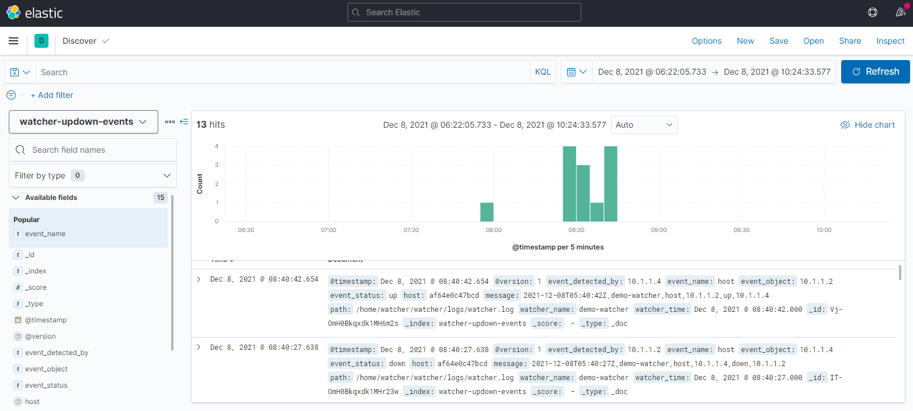
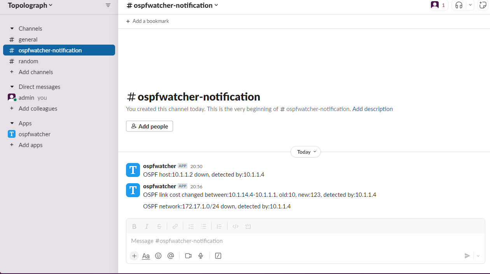
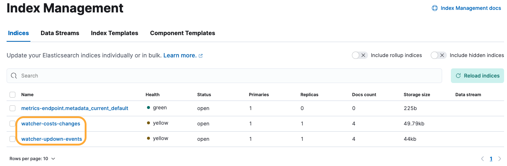
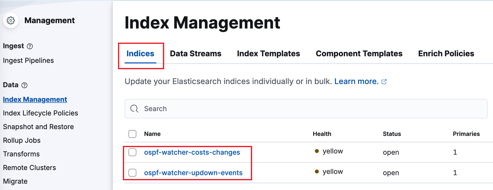
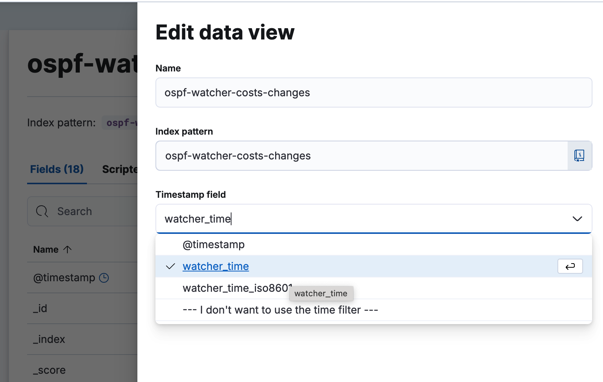
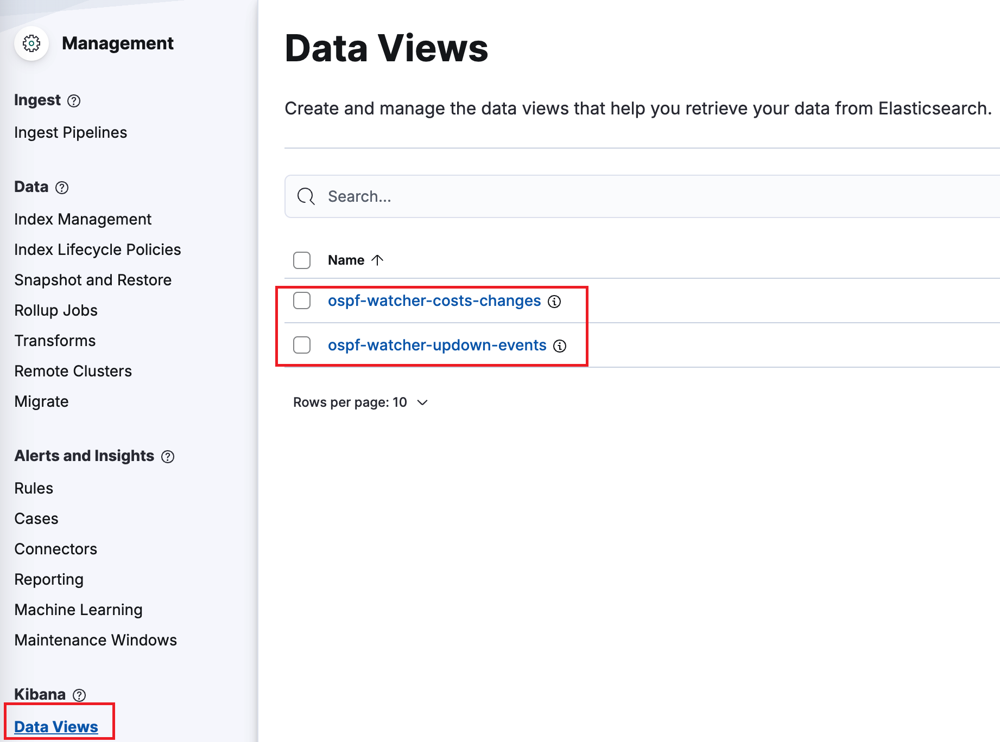

# Other exports: ELK, Zabbix, Loki, webhooks

A watcher writes its events to text logs. Logstash or Fluent Bit can pass them on. This page covers Kibana, Zabbix, Slack and other webhooks, Loki, and the manual setup of a watcher by hand.

## Discovering OSPF logs in Kibana. Examples
OSPF cost changes on links  


Logs if OSPF adjacency was Up/Down or any networks appeared/disappeared.  



## OSPF topology change notification/alarming via Zabbix. Examples
Zabbix's dashboard with active OSPF alarms detected by OSPFWatcher  


### Zabbix OSPF neighbor up/down alarm
This alarm tracks all new OSPF adjacencies or when device loses its OSPF neighbor


### Zabbix OSPF Cost changed on transit links
Transit links are all links between active OSPF neighbors. If cost on a link was changed it might affect all actual/shortest paths traffic follows 


### Zabbix alert if OSPF network was stopped announcing from node
If a subnet was removed from OSPF node (the node withdrew it from the announcement) it means the network from this node became unavailable for others, this event will be logged too.


### Slack notification
HTTP POST messages can be easily accepted by messengers, which allows to get instant notifications of OSPF topology changes:



## Push OSPF topology changes to Loki

You can configure [Loki](https://grafana.com/oss/loki/) to receive topology changes. Edit `.env` and set `EXPORT_TO_LOKI_BOOL` and `LOKI_URL`.

Both shippers declare the same stream labels, so one set of Grafana queries
works whichever of them you run:

| Label | Values |
|---|---|
| `job` | `topolograph-ospf` |
| `event_name` | `network`, `host`, `metric`, `temetric`, `node` |
| `event_status` | `up`, `down`, `changed` |
| `area_num` | `0.0.0.0` (OSPF area) |
| `asn` | autonomous system number, e.g. `65001` |
| `watcher_name` | name of the watcher that reported the event |

Example query: `{job="topolograph-ospf", event_status="down"}`


## How to connect OSPF watcher to real network  
Table below shows different options of possible setups, starting from the bare minimum in case of running Containerlab for testing and ending with maximum setup size with Watcher, Topolograph and ELK. Setup **№4** is a watcher installed from Topolograph's Monitoring page, see the [README](../README.md#quick-start). Setups №2 and №3 are set up by hand and feed ELK, Zabbix, Loki and webhooks. 
| № | Deployment size | Compose files | Text logs | View on map | Zabbix / HTTP / Messengers | Search events |
|---|----------------|---------------|-----------|-------------|---------------------------|---------------|
| 1 | Bare minimum (Containerlab) | 0 | + | − | − | − |
| 2 | Manual setup, no Topolograph, ELK **disabled** | 1 | + | − | + | − |
| 3 | Manual setup, no Topolograph, ELK **enabled** | 2 | + | − | + | + |
| 4 | Enterprise: installed from Topolograph's Monitoring page: Topolograph + **Fluent Bit** | 2 | + | + | HTTP/Webhook only | − |

<details>
<summary><b>Manual setup</b> without Topolograph (text logs, ELK, Zabbix, Loki, webhooks)</summary>

## Setup №2. Text logs, Zabbix, webhooks and Loki without Topolograph
1. Choose a Linux host with Docker installed

> [!NOTE]
> * `TEST_MODE` - if mode is `True`, a demo OSPF events from static file will be
>   uploaded, not from FRR

**2. Setup OSPF Watcher**
```bash
git clone https://github.com/Vadims06/ospfwatcher.git
cd ospfwatcher
cp .env.template .env
```
Generate configuration files  
`vadims06/ospf-watcher:v1.7` includes a client for generating configurations for each Watcher for each OSPF area. To generate individual settings - run the client with `--action add_watcher`   
```
sudo docker run -it --rm --user $UID -v ./:/home/watcher/watcher/ -v /etc/passwd:/etc/passwd:ro -v /etc/group:/etc/group:ro vadims06/ospf-watcher:latest python3 ./client.py --action add_watcher
```   
Output:   
```
+---------------------------+
|  Watcher Host             |                       +-------------------+
|  +------------+           |                       | Network device    |
|  | netns FRR  |           |                       |                   |
|  |            Tunnel [4]  |                       | Tunnel [4]        |
|  |  gre1   [3]TunnelIP----+-----------------------+[2]TunnelIP        |
|  |  eth1------+-ospf1-gre1|       +-----+         | OSPF area num [5] |
|  |            | Host IP[6]+-------+ LAN |--------[1]Device IP         |
|  |            |           |       +-----+         |                   |
|  +------------+           |                       |                   |
|                           |                       +-------------------+
+---------------------------+
[1]Network device IP [x.x.x.x]: 
```
The script will create:
1. a folder under `watcher` folder with FRR configuration under `router` folder
2. a containerlab configuration file with network settings
3. an individual watcher log file in `watcher` folder.  

OSPF routes of each Watcher instance stay isolated in watcher's network namespace. To stop OSPF routes from being installed even in the watcher's network namespace, we the following policy has been applied on the watcher:
```bash
# quagga/config/ospfd.conf
route-map TO_KERNEL deny 200
exit
!
ip protocol ospf route-map TO_KERNEL
```

5. Start OSPF Watcher  
[Install](https://containerlab.srlinux.dev/install/) containerlab
To start the watcher run the following command. `clab deploy` is like a `docker compose up -d` command   
```
sudo clab deploy --topo watcher/watcher1-tun1025/config.yml
```
It will create:
* Individual network namespace for Watcher and FRR
* A pair of tap interfaces to connect the watcher to Linux host
* GRE tunnel in Watcher's namespace
* NAT settings for GRE traffic
* FRR & Watcher instance
* attach the announcement filter to gre1 egress in the watcher namespace

6. Start log export to ELK, Zabbix, Loki or webhooks (optionally if you set up ELK)  
```
docker-compose build
docker-compose up -d
```  

**Compose profiles (Logstash vs Fluent Bit):**  
- **Default (no profile):** starts Logstash and the index-creator. Use `docker compose up -d` (or `docker compose up -d ospf-logstash ospf-logstash-index-creator`).
- **Fluent Bit only:** the `fluent-bit` service has profile `fluent-bit`. To start **only** Fluent Bit (no Logstash, no index-creator), run:
  ```bash
  docker compose --profile fluent-bit up -d fluent-bit
  ```
  Pipeline definition: [`fluentbit/fluent-bit.yaml`](../fluentbit/fluent-bit.yaml) (bind-mounted into the container). Logstash and Fluent Bit send HTTP payloads in different shapes; see **HTTP output: Logstash vs Fluent Bit** under *Minimum version*.

</details>

<details>
<summary><b>Manual setup</b>: ELK, only for setup №3</summary>

Setup ELK (skip it, it's only needed for setup № 3)  
* if you already have ELK instance running, fill `ELASTIC_IP` in env file and uncomment Elastic config here `ospfwatcher/logstash/pipeline/logstash.conf`. Currently additional manual configuration is needed for Index Templates creation, because `create.py` script doesn't accept the certificate of ELK. It's needed to have one in case of security setting enabled. Required mapping for the Index Template is in `ospfwatcher/logstash/index_template/create.py`.
To create Index Templates, run:
```
sudo docker run -it --rm --env-file=./.env -v ./logstash/index_template/create.py:/home/watcher/watcher/create.py vadims06/ospf-watcher:latest python3 ./create.py
```   
* if not - boot up a new ELK from [docker-elk](https://github.com/deviantony/docker-elk) compose. For demo purporse set license of ELK as basic and turn off security. The setting are in docker-elk/elasticsearch/config/elasticsearch.yml  
```
xpack.license.self_generated.type: basic
xpack.security.enabled: false
```  

> [!TIP]
> When the Elastic output plugin fails to connect to the ELK host, it blocks all
> other outputs and ignores `EXPORT_TO_ELASTICSEARCH_BOOL` value from env file.
> Regardless of `EXPORT_TO_ELASTICSEARCH_BOOL` being `False`, it tries to
> connect to Elastic host. The solution - uncomment this portion of config in
> case of having running ELK.

</details>

 ## Kibana settings
 1. **Index Templates** 
 Have been already created by `ospf-logstash-index-creator` container in compose yaml file.
 Open `Management -> Stack Management -> Index Management ->[ Index Templates ]` to make sure that the following templates are in the list:
    * `ospf-watcher-costs-changes`
    * `ospf-watcher-updown-events`     
    
 2. **Index Pattern**
 Create indices with the same name as index templates
 Go to:
 old ELK `Stack Management/ Kibana/ Stack Management/ Index Pattern -> Create index pattern`
 new ELK 8.x `Management -> Stack Management -> Index Management -> [ Indices ]`

    then `Create index`
    * ospf-watcher-costs-changes
    * ospf-watcher-updown-events
 

 3. **Data View**
  Create data view for two event types.
  Go to `Management -> Stack Management -> Data Views`
  then `Create data view`
    ```
    Name: ospf-watcher-costs-changes
    Index pattern: ospf-watcher-costs-changes
    Timestamp field: use watcher time
    ```
       
    Repeat the same for `ospf-watcher-updown-events`
   As a result, there are two data views should be listed
   

> [!TIP]
> What time to use @timestamp or watcher?
> 
> It's better to use `watcher` time, because connection between Watcher and
> Logstash can be lost, but the watcher continues to log all topology changes
> with the correct time. When the connection is repaired, all logs will be added
> to ELK and you can check the time of the incident. If you choose `@timestamp`
> - the time of all logs will be the time of their addition to ELK.

 4. **Additional checks**
  Make sure that:
    * `.env` has `EXPORT_TO_ELASTICSEARCH_BOOL=True`
    * `./logstash/pipeline/logstash.conf` has ELK uncommented
 ## Browse your topology changes logs
 Your logs are here http://localhost:5601/ -> `Analytics/Discover` `watcher-updown-events`. 
 
 ## Zabbix settings
 Zabbix settings are available here ```/docs/zabbix-ui```. There are 4 hosts and items (host and item inside each host has the same names) are required:
 * ospf_neighbor_up_down
 * ospf_network_up_down
 * ospf_link_cost_change
 * ospf_stub_network_cost_change

 ## WebHook setting
1. Create a Slack app
2. Enable Incoming Webhooks
3. Create an Incoming Webhook (generates URL)
4. Uncomment `EXPORT_TO_WEBHOOK_URL_BOOL` in `.env`, set the URL to `WEBHOOK_URL`


### Logs sample 1  
```
2023-01-01T00:00:00Z,demo-watcher,host10.10.10.4,down,10.10.10.5,01Jan2023_00h00m00s_7_hosts,0,1234,192.168.145.5
```

* `2023-01-01T00:00:00Z` - event timestamp
* `demo-watcher` - name of watcher
* `host` - event name: `host`, `network`, `metric`
* `10.10.10.4` - event object. Watcher detected an event related to `10.10.10.4` host
* `down` - event status: `down`, `up`, `changed`
* `10.10.10.5` - event detected by this node.
* `01Jan2023_00h00m00s_7_hosts` - name of graph in Topolograph dashboard
* `0.0.0.0` - OSPF area ID
* `1234` - AS number where OSPF is working
* `192.168.145.5` - IP address on detected node
*Summary: `10.10.10.5` detected that `10.10.10.4` host on the interface with `192.168.145.5` IP address in area 0 in AS 1234 went down at `2023-01-01T00:00:00Z`*

### Logs sample 2  
```
2023-01-01T00:00:00Z,demo-watcher,network,192.168.13.0/24,changed,old_cost:10,new_cost:12,10.10.10.1,01Jan2023_00h00m00s_7_hosts,0.0.0.0,1234,internal,0
```

* `2023-01-01T00:00:00Z` - event timestamp
* `demo-watcher` - name of watcher
* `metric` - event name: `host`, `network`, `metric`
* `192.168.13.0/24` - event object. Watcher detected an event related to `192.168.13.0/24` subnet
* `changed` - event status: `down`, `up`, `changed`
* `10` - old cost
* `12` - new cost
* `10.10.10.1` - event detected by this node.
* `01Jan2023_00h00m00s_7_hosts` - name of graph in Topolograph dashboard
* `0.0.0.0` - OSPF area ID
* `1234` - AS number where OSPF is working
* `internal` - type of network: `internal` or `external`
* `0` - subtype of network: type-1, type-2 or 0 for internal subnets
*Summary: `10.10.10.1` detected that metric of `192.168.13.0/24` internal stub network changed from `10` to `12` at `2023-01-01T00:00:00Z` in area 0*


## Development   
Logstash pipeline development.
Start logstash container
```
[ospf-watcher]# docker run -it --rm --env-file=./.env -v ./logstash/pipeline:/usr/share/logstash/pipeline -v ./logstash/config:/usr/share/logstash/config ospfwatcher_watcher:latest /bin/bash
```
Inside container run this command:
```
bin/logstash
```
It will expect watcher's log file change, so add new log (copy and paste this line) into `./watcher/logs/watcher#-gre#-ospf.ospf.log` file
```
2023-01-01T00:00:00Z,watcher-local,network,10.1.14.0/24,changed,old_cost:10,new_cost:123,10.1.1.4,01Jan2023_00h00m00s_7_hosts,0.0.0.0,12345,internal,0
```
The output should be:
```
[INFO ] 2024-05-13 21:15:25.462 [[main]-pipeline-manager] javapipeline - Pipeline started {"pipeline.id"=>"main"}
The stdin plugin is now waiting for input:
[INFO ] 2024-05-13 21:15:25.477 [Agent thread] agent - Pipelines running {:count=>1, :running_pipelines=>[:main], :non_running_pipelines=>[]}
2023-01-01T00:00:00Z,watcher-local,network,10.1.14.0/24,changed,old_cost:10,new_cost:123,10.1.1.4,01Jan2023_00h00m00s_7_hosts,0.0.0.0,12345,internal,0
{
                            "graph_time" => "01Jan2023_00h00m00s_7_hosts",
                     "event_detected_by" => "10.1.1.4",
                           "subnet_type" => "internal",
                        "int_ext_subtype"=> "0",
                                   "asn" => "12345",
                          "watcher_name" => "demo-watcher",
                          "watcher_time" => "2023-01-01T00:00:00Z",
                            "@timestamp" => 2024-05-13T21:15:50.628Z,
                              "old_cost" => "10",
                              "@version" => "1",
                                  "host" => "ba8ff3ab31f8",
                            "event_name" => "network",
                              "new_cost" => "123",
                          "event_object" => "10.1.14.0/24",
                          "event_status" => "changed"
}
```
Add your changes in `./logstash/pipeline` file, stop logstash process via CTRL+C `bin/logstash` and start it again. Add the same log in the watcher's log file and check how logstash works with your new changes.

## Troubleshooting Logstash
1. Check that `ospf-logstash` from [docker-compose.yml](../docker-compose.yml) is running: `sudo docker ps`.
2. Uncomment `DEBUG_BOOL="True"` in `.env` and follow `sudo docker logs -f ospf-logstash`.
3. Copy a line from the watcher log and append it to the same file, `watcher/logs/watcher<num>-....ospf.log`: the Logstash log should print it. If not, check the Logstash container.

## Minimum Logstash version
 7.17.21, this version includes bug fix of [issues_281](https://github.com/logstash-plugins/logstash-input-file/issues/281), [issues_5115](https://github.com/elastic/logstash/issues/5115)

> [!NOTE]
> **HTTP output: Logstash vs Fluent Bit** — the `http` plugins use different `format` options and batching rules. Align the receiver (e.g. Topolograph `/websocket`) with the body shape you send.
>
> * **Logstash** ([http output](https://www.elastic.co/guide/en/logstash/current/plugins-outputs-http.html)): `format` is one of `json` (default), `json_batch`, `form`, or `message`. With **`json`**, each request body is typically **one JSON object per event**. With **`json_batch`**, each request sends **one JSON array** containing a whole pipeline batch (common for Logstash-to-Logstash). `content_type` defaults from `format` (e.g. `application/json` for `json` / `json_batch`).
> * **Fluent Bit** ([http output](https://docs.fluentbit.io/manual/pipeline/outputs/http)): `Format` is one of `json` (default), `json_lines`, `json_stream`, `msgpack`, or `gelf`. With **`json`**, the body is a **JSON array** of records for a flush chunk. **`json_lines`** is newline-delimited JSON (one object per line). How many records appear in one POST is driven mainly by the engine **chunk** and the global **[SERVICE] `Flush`** interval, not by Logstash’s `json` vs `json_batch` switch.
>
> Example Fluent Bit pipeline for this repo: [`fluentbit/fluent-bit.yaml`](../fluentbit/fluent-bit.yaml).
